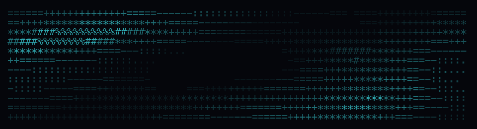
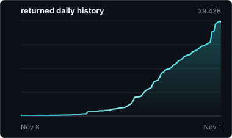

  

hi! i'm ganesh and below you can find most of the projects i've worked on throughout the years (all the way back to 2021!)

for my full profile, visit [ganeshtalluri.com](https://ganeshtalluri.com/)

<!-- codex-token-counter:start -->
#### my codex usage across devices

<table width="100%">
  <thead>
    <tr>
      <th align="left" width="18%">stat</th>
      <th align="left" width="36%">value</th>
      <th align="right" width="46%">tokens over time</th>
    </tr>
  </thead>
  <tbody>
    <tr>
      <td width="18%">lifetime tokens</td>
      <td width="36%">40,627,742,994 (40.63B)</td>
      <td rowspan="6" width="46%" valign="middle" align="right"></td>
    </tr>
    <tr>
      <td>est. API cost</td>
      <td>$54,908.95</td>
    </tr>
    <tr>
      <td>current streak</td>
      <td>131 days</td>
    </tr>
    <tr>
      <td>daily history</td>
      <td>Nov 17, 2025 -&gt; Nov 9, 2026</td>
    </tr>
    <tr>
      <td>history tokens</td>
      <td>40,627,742,994</td>
    </tr>
    <tr>
      <td>updated</td>
      <td>Nov 9, 2026, 5:56 PM MST</td>
    </tr>
  </tbody>
</table>
<!-- codex-token-counter:end -->
